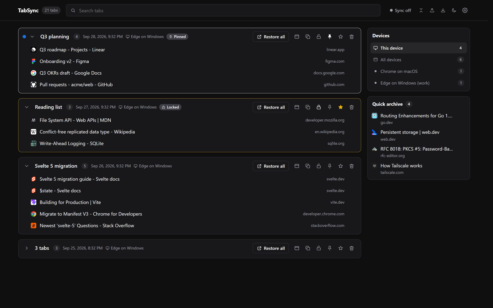
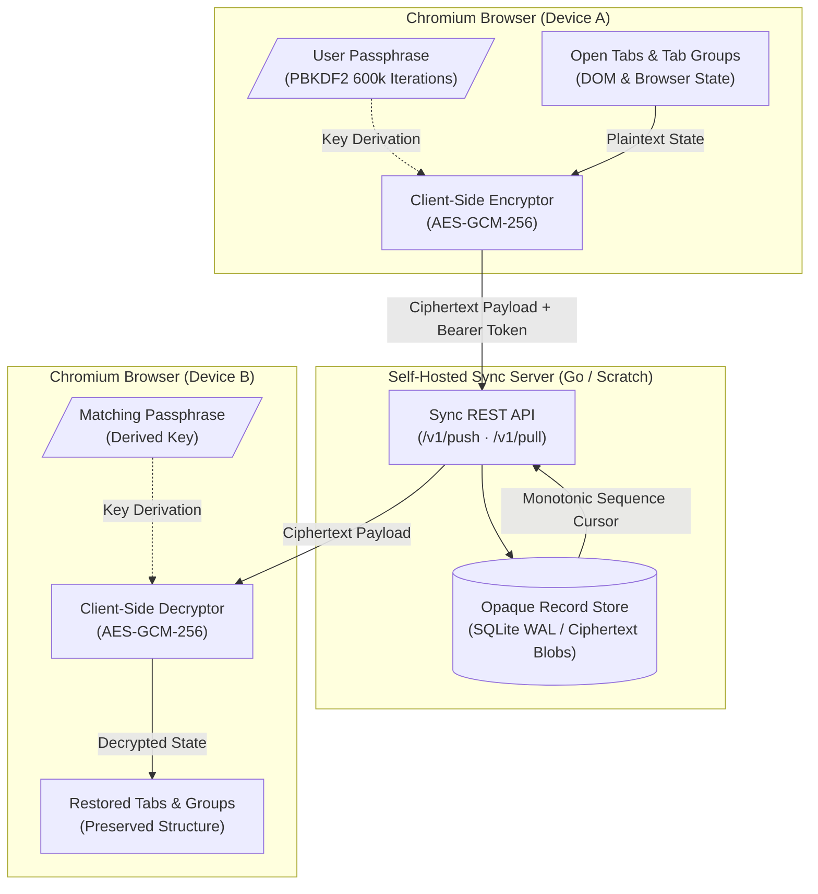
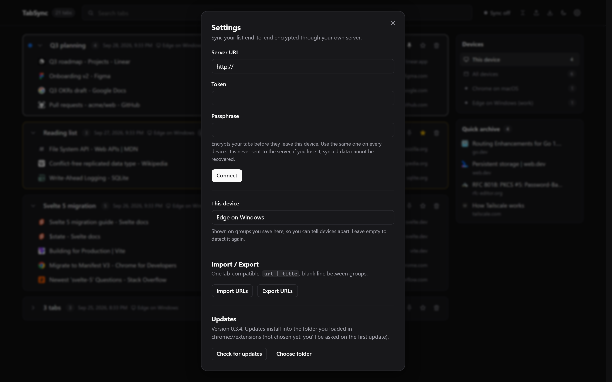

<div align="center">

# TabSync

### Zero-Knowledge, End-to-End Encrypted Tab Manager & Cross-Device Sync

A privacy-first, self-hosted tab manager and cross-device sync extension for Chromium browsers. Client-side AES-GCM-256 encryption, zero-knowledge Go sync server, OneTab export/import format compatibility, and Chrome tab group preservation.

[](#tech-stack-matrix)
[](#tech-stack-matrix)
[](#zero-knowledge-security-architecture)
[](#self-hosted-sync-server-deployment)
[](LICENSE)

[Quick start](#quick-start) · [Architecture](#zero-knowledge-security-architecture) · [Features](#key-features) · [Server deployment](#self-hosted-sync-server-deployment) · [Troubleshooting](#troubleshooting)

<br/><br/>

<picture>
  <source media="(prefers-color-scheme: light)" srcset="docs/list-light.png">
  
</picture>

</div>

---

> Built for privacy-conscious power browsers: collapse hundreds of open tabs into an organized list and sync them across devices through a tiny server you control — zero monthly subscriptions, zero telemetry, and zero unencrypted data leaving your machine.

---

## Zero-Knowledge Security Architecture

TabSync uses a zero-knowledge trust model. Your unencrypted tab data, group titles, and URLs never leave your browser unencrypted. The backend operates strictly as an opaque record store.



### Cryptographic Guarantees & Sync Protocol

- **Client-Side Key Derivation**: Keys are derived locally via the Web Crypto API (`crypto.subtle`) using PBKDF2-SHA256 with 600,000 iterations and a cryptographically secure random salt.
- **Authenticated Encryption**: Every tab record and group metadata payload is encrypted independently using AES-GCM-256 with a unique 12-byte initialization vector (`iv`).
- **Zero-Knowledge Backend**: The Go server receives and persists only opaque Base64-encoded ciphertext blobs (`iv || ciphertext`). It has no access to plaintext URLs, titles, or encryption keys.
- **Passphrase Handshake**: During setup, `/v1/meta` stores an encrypted verifier token (`tabsync-ok`). Subsequent devices test passphrases locally without transmitting credentials over the wire.
- **Conflict-Free Delta Sync**: Synchronization tracks client timestamps and server-assigned monotonic sequence numbers. Concurrent modifications resolve with last-writer-wins per record, and group deletions cleanly tombstone associated items.

---

## Key Features

<table>
  <tr>
    <td width="50%" valign="top">
      <h4>Tab Organization & Browser Integration</h4>
      <ul>
        <li><strong>One-Click Collapse</strong>: Send active tab, selection, current tab group, or entire window into organized lists.</li>
        <li><strong>Chrome Tab Group Preservation</strong>: Retains group names, colors, and structure upon restoration.</li>
        <li><strong>Selective Restoration</strong>: Click to restore and remove, or hold <code>Ctrl</code>/<code>Cmd</code> / lock group to keep permanently.</li>
        <li><strong>Inline Organization</strong>: Rename groups inline, pin/star groups, drag tabs, collapse, and instant search across titles/URLs.</li>
        <li><strong>Quick Archive Sidebar</strong>: Right-click any link to save into a persistent sidebar without cluttering active groups.</li>
        <li><strong>OneTab Compatibility</strong>: Native bidirectional import/export in standard <code>url | title</code> format.</li>
      </ul>
    </td>
    <td width="50%" valign="top">
      <h4>Zero-Knowledge Sync & Privacy</h4>
      <ul>
        <li><strong>End-to-End Encryption (E2EE)</strong>: Data is encrypted client-side with AES-GCM-256 before leaving the browser; server stores only ciphertext.</li>
        <li><strong>Zero-Knowledge Authentication</strong>: Token hash verification prevents server from discovering user passphrases.</li>
        <li><strong>Lightweight Go Sync Daemon</strong>: Single static binary consuming &lt; 15MB RAM with Docker distroless deployment.</li>
        <li><strong>Per-Device Profiling</strong>: Tags groups by device origin with sidebar filtering (Current Device, All Devices, Remote Device).</li>
        <li><strong>In-App Automatic Updates</strong>: Update extension directly from private GitHub releases without Chrome Web Store delays.</li>
        <li><strong>Modern Aesthetics</strong>: Responsive light, dark, and AMOLED-compatible themes.</li>
      </ul>
    </td>
  </tr>
</table>

<div align="center">
  
</div>

---

## Tech Stack Matrix

| Layer | Technology | Purpose |
|---|---|---|
| **Extension Core** | Chrome Manifest V3 | Background service worker, context menus, and storage alarms |
| **Cryptography** | Web Crypto API (`crypto.subtle`) | Client-side PBKDF2-SHA256 key derivation & AES-GCM-256 encryption |
| **Sync Daemon** | Go 1.23 (`net/http`) | Minimalist, single-binary REST API server (`/v1/push`, `/v1/pull`) |
| **Database Engine** | SQLite (`modernc.org/sqlite`) | CGO-free, embedded transactional storage with WAL mode enabled |
| **Containerization** | Docker Distroless (`scratch`) | Hardened scratch image with non-root user and 64MB memory limit |
| **User Interface** | Vanilla JavaScript / Svelte + Vite | Responsive, theme-aware tab management interface and options modal |

---

## Quick Start

### 1. Install Extension

1. Download `tabsync-vX.Y.Z.zip` from the latest [GitHub Release](https://github.com/samsmon/tabsync/releases/latest) assets.
2. Extract the archive into a permanent folder on your machine.
3. Open `chrome://extensions` in any Chromium browser (Chrome, Edge, Brave, Arc).
4. Enable **Developer mode** (toggle in the top-right header).
5. Click **Load unpacked** and select the extracted folder.

> **In-App 1-Click Updates**: When a new release is published, TabSync displays an update banner. Upon first update, select your extension folder once via the File System Access API. Subsequent updates download and refresh seamlessly in one click without touching your tabs.

---

## Self-Hosted Sync Server Deployment

The TabSync server is distributed as a lightweight container based on `scratch` with zero external runtime dependencies.

### Deploy with Docker Compose (Recommended)

```bash
# 1. Generate a strong shared bearer token
echo "TABSYNC_TOKEN=$(openssl rand -hex 32)" > .env

# 2. Build and run container in detached mode
docker compose up -d --build

# 3. Verify daemon health
curl -f http://localhost:8097/healthz
```

### Run Native Go Binary

```bash
# Navigate to server directory
cd server

# Set mandatory token and start daemon
export TABSYNC_TOKEN="your-secure-bearer-token-min-16-chars"
go run ./main.go
```

### Production HTTPS Reverse Proxy (Caddy Example)

The Web Crypto API requires a secure context (HTTPS) when accessed outside `localhost`. Use Caddy for automated TLS certificates:

```caddy
sync.yourdomain.com {
    reverse_proxy localhost:8097
}
```

### Connect Extension to Server

1. Open TabSync and click the **Settings** gear icon.
2. Under **Sync Server**, enter your server URL (e.g., `https://sync.yourdomain.com`).
3. Enter your shared `TABSYNC_TOKEN` and choose a master **Passphrase**.
4. Repeat on other devices using the **exact same passphrase** to sync your tabs.

---

## Server Configuration Reference

Configure the sync daemon via environment variables or a `.env` file:

| Variable | Default | Purpose |
|---|---|---|
| `TABSYNC_TOKEN` | *(required)* | Shared bearer authentication token for all your devices (min 16 chars) |
| `TABSYNC_DB` | `/data/tabsync.db` | SQLite database file location (WAL mode enabled) |
| `TABSYNC_ADDR` | `:8080` | Network host and port to bind the HTTP server |
| `GOMEMLIMIT` | `32MiB` | Go runtime memory ceiling to prevent memory bloat |
| `GOGC` | `50` | Aggressive garbage collection trigger percentage |

---

## Local Development & Extension Build

```bash
# Install frontend build dependencies
cd ext
npm install

# Watch mode with hot builds into dist/
npm run dev

# Execute data layer and crypto unit tests
npm test

# Production extension bundle build
npm run build
```

---

## Troubleshooting

| Symptom / Error | Probable Cause | Immediate Remediation |
|---|---|---|
| **Passphrase lost** | Forgotten encryption passphrase | **Unrecoverable by design.** Keys are derived locally and never sent to server. Clear local storage and reset profile. |
| **`SubtleCrypto` unavailable** | Non-HTTPS sync URL | Chromium restricts Web Crypto API to secure contexts. Put sync server behind HTTPS reverse proxy (Caddy / Nginx). |
| **`401 Unauthorized`** | Token mismatch | Ensure `TABSYNC_TOKEN` in server environment matches the token in extension Settings. |
| **Auto-update file access error** | Directory permissions revoked | Re-select the local extension folder when prompted by the File System Access API picker. |
| **Sync conflict / stale cursor** | Clock drift or interrupted sync | Force full resync by toggling sync off and on in TabSync Settings dialog. |

---

## Modular Documentation Index

| Component | File Reference | Description |
|---|---|---|
| **Extension Manifest** | [`ext/public/manifest.json`](ext/public/manifest.json) | Chromium Manifest V3 declarations, permissions, and icons |
| **Crypto Implementation** | [`ext/src/lib/crypto.js`](ext/src/lib/crypto.js) | PBKDF2 key derivation and AES-GCM-256 encrypt/decrypt logic |
| **Sync Protocol** | [`ext/src/lib/sync.js`](ext/src/lib/sync.js) | Client-side cursor pull/push, verifier setup, and tombstone logic |
| **Server Implementation** | [`server/main.go`](server/main.go) | Zero-knowledge Go HTTP server and SQLite schema handler |
| **Container Spec** | [`compose.yml`](compose.yml) | Docker Compose service configuration and volume mounts |

---

## License

Distributed under the [MIT License](LICENSE).

<p align="center">
  <a href="#tabsync">↑ Back to Top</a>
</p>
